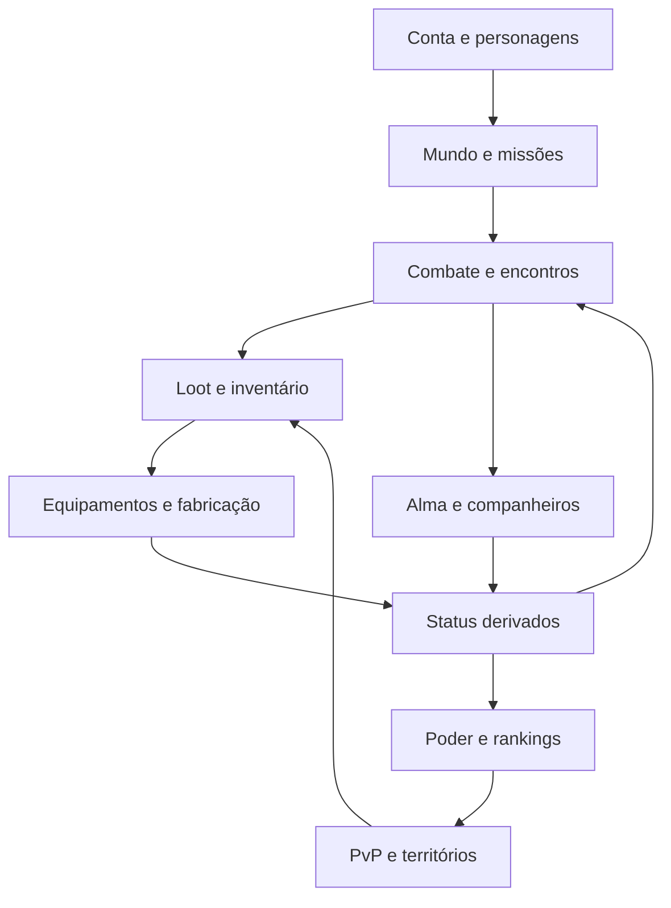
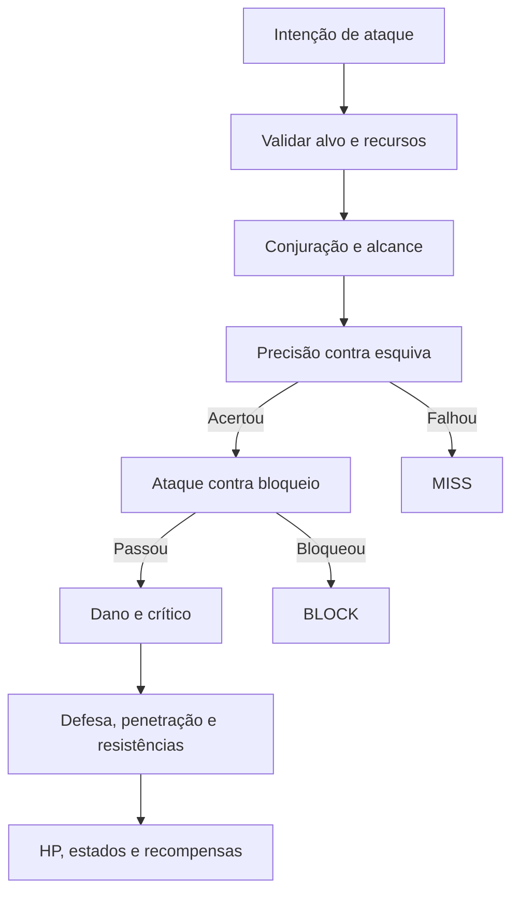

# Elyndra — estudo de Asa de Cristal e Cabal para mobile

Versão do estudo:1.0 ·24/10/2026. Base examinada:Crystal Saga clássico daR2Games, referência internacional doAsa de Cristal. Guias consultados têm publicações históricas; servidores brasileiros, privados eCrystal SagaII podem divergir. Este documento não afirma cobrir todos os conteúdos de todas as edições.

**Resultado:** há material oficial suficiente para reconstruir a organização dos sistemas essenciais. As fórmulas internas completas, probabilidades de todos os drops e código de servidor não são públicos nas fontes consultadas. A implementação deve separar regra confirmada, escolha deElyndra e hipótese a medir. A documentação abaixo é especificação de produção; não declara que tudo já está implementado.

##1. Evidências e decisões

|Sistema|Regra encontrada na documentação|Adaptação deElyndra|
|---|---|---|
|Interface|Personagem, mochila, skills, missões, montarias, asas, eventos, grupo e loja têm acessos próprios; existe ajuste para ocultar efeitos.[CS1]|Mesma separação funcional em uma navegação de toque, com uma única janela principal aberta.|
|Asas|Quest concede asas no20; evolução acrescenta propriedades e usa materiais obtidos no jogo ou na loja.[CS2]|Manter0–100 e formas próprias, respeitando o requisito250paraUltra solicitado. Prévia, custo e ação visíveis juntos.|
|Alma/aura|Alma abre no30; evolução depende de requisitos e gera progresso. Auras especiais aparecem em marcos de500,1100,1700,2300,3000.[CS3]|Construir Alma com nós de desenvolvimento e aura associada aos marcos. O atual sistema separado de aura100precisa de uma migração explícita, preservando o investimento.|
|Pets|Captura usa pergaminho e depende de nível/HP do monstro. Há diferenças de aptidão/maturidade, evolução e funções.[CS4]|Catálogo, captura, treino, transformação e comportamento em combate. Os atuais pets dão bônus e acompanham, mas ainda não equivalem ao sistema completo.|
|Montarias|O guia introdutório descreve quest inicial no15e crescimento por alimentação/transformação.[CS9]|Experiência, formas e atributos de nível1–100, separando montado/equipado e bônus persistente.|
|Skills|Asa distingue talentos e passivas; o guia explica pontos de habilidade a cada dois níveis.[CS9]|Preservar nossas7classes e20níveis por skill; decisões de especialização devem ser adicionadas sem copiar cegamente a quantidade de pontos do original.|
|Classes|Clássico possuiKnight,Rogue,Priest,Ranger,Mage, com duas linhas por classe.[CS8]|Manter as sete classes pedidas; falta uma função de cura/suporte de grupo suficiente paraDGs cooperativas.|
|DGs|Há dificuldades, materiais/equipamentos específicos e limites de entrada. O guia enfatiza grupo e papéis.[CS5]|Recompensas por faixa até250, solo/grupo claramente identificados e mecânicas reais antes de liberar cooperação.|
|Aprimorar|A interface oferece seleção automática dos materiais e alternativa que sugere compra dos faltantes; arma ganha luz em patamares.[CS6]|Manter+0–25, chance/custo/garantia claros e confirmação para cash; brilho deve acompanhar a geometria da arma.|
|Slots|Gemas entram em encaixes e abertura pode consumir item especial.[CS7]|Três opções nativas mais dois slots; extensão para três a partir175, conforme suas regras. Valores por grau continuam separados.|
|Comércio|Loja de jogador permite expor itens com preço e exige permanecer online no guia clássico.[CS10]|Leilão persistente com servidor e custódia dos itens; a melhoria mobile deve permitir listar sem deixar o telefone aberto.|
|Eventos|O guiaPlunder exemplificaPvP associado a entrega de item e recompensa.[CS11]|Eventos com objetivos, regras de elegibilidade e recompensa exclusiva; não basta contar abates.|

### O que veio doCabal

A fonte oficial separa precisão/esquiva de taxa de ataque/taxa de defesa: primeiro pode ocorrerMISS; depoisBLOCK; só então dano. A sequência documentada usa a categoria da habilidade,AMP correspondente, crítico e resistências, defesa/penetração, modificadores aditivos e finais. O guia informa5%de taxa crítica inicial, limite inicial50%e dano crítico adicional inicial20%.[CB1]

Equipamentos distinguem base, opção épica e opção de slot; fabricação pode produzir opções épicas.[CB2] Atribuição de slots tem materiais, probabilidades e restrições por peça/grau.[CB3] Logo, a nossa regra de três opções aleatórias e terceiro slot por chefe é uma adaptação própria, e não uma descrição literal doCabal.

##2. Contratos que permanecem seus

- Nível máximo250;5pontos por nível ganho, total1245no250.
- FOR,INT eDES com crescimento próprio por classe.
- Arqueiro centrado em básico, velocidade, precisão e crítico;AMP só beneficia suas skills.
- Ruptor usa arma longa de duas mãos, orçamento de duas armas e secundária reservada.
- Equipamentos exclusivos por classe, três opções nativas e até três slots.
- Encantamento aumenta a base, preservando opções nativas e runas.
- Asas,aura,Magículas,pets e montarias até100;UltraPrimordial exige250.
- Três divisões de chefes;Cataclismos175–250com retorno24h após a morte e materiais exclusivos.
- Duas nações;guildas com habilidade liberada a partir15, conforme a sua regra.
- Ataque comandado pelo jogador. Caminhar ao objetivo da missão pode ser automático.
- Ouro e cash separados. Cash de teste noGM é simulado.

Se uma regra do jogo de referência conflitar com esses contratos, a decisão precisa ser registrada. Uma cópia literal doAsa clássico mudaria classes, limites e progressão que você já definiu.

##3. Arquitetura dos sistemas

O servidor deve guardar níveis, equipamentos, itens, dinheiro, rolagens, relógios de chefes e recompensas. O cliente recebe o resultado e desenha a ação. O perfilGM precisa ser uma permissão de servidor numa versão conectada; oGM da0.16é somente uma ferramenta local de testes.

### Componentes e responsabilidade

|Componente|Responsabilidade|Não deve fazer|
|---|---|---|
|Input|Traduzir toque/joystick em intenção|Dar dano ou criar item diretamente|
|CombatResolver|Validar alcance, alvo, mana, cooldown e impacto|Depender da animaçãoCSS para causar dano|
|CharacterStats|Recalcular os atributos de todas as fontes|Somar poder arbitrário por raridade|
|Inventory/Crafting|Validar e aplicar uma transação única|Consumir duas vezes por toque repetido|
|Progression|XP, atributos, treino e requisitos|Usar contadores visuais como estado real|
|World/Encounters|Navegação, aggro, reset, fases e spawn|Executar tudo a cada frame de desenho|
|Renderer/VFX|Animação, efeitos, camadas e legibilidade|Conter a regra econômica ou dePvP|
|Rankings|Ordenar métricas verificadas|MisturarGM com jogadores normais|

##4. Diagrama de combate

A ordem conceitual segue a documentaçãoCB1. As funções numéricas abaixo são propostas deElyndra; não são fórmulas oficiais recuperadas dos jogos.

### Representação e fórmula proposta

Guardar percentuais em pontos-base:10000=100%,700=7%. Exibir percentual e pontos percentuais de maneira diferente. Arredondar o dano uma vez no fechamento do impacto e manter saldos como inteiros seguros.

Para uma habilidade:

1. EscolherAF/AMPespada/penetração física,AM/AMPmagia/penetração mágica ou os componentes do híbrido.
2. Base = ataque da categoria × coeficiente treinado + parcela fixa da skill.
3. AMPefetiva=max(0,AMP−max(0,resistênciaAMP−ignorarResistênciaAMP)).
4. Taxa crítica efetiva=clamp(min(taxa,limite)−max(0,resistênciaTaxa−ignorarResistênciaTaxa),0,1).
5. Multiplicador crítico=1+max(0.20,danoCríticoAdicional−resistênciaEfetiva).
6. Defesa efetiva=max(0,defesa−penetraçãoEfetiva). A curva de mitigação precisa de parâmetro por faixa de nível e calibração; a atualcurvaK=1000deElyndra não deve ser anunciada comoCabal.
7. Aplicar redução por impacto, modificadoresPvE/PvP e limites do modo; habilidade de múltiplos golpes deve respeitar orçamento por execução, evitando contornar o teto dividindo um ataque em muitas parcelas.

Exemplo próprio:AF1000,coeficiente1,5,AMP20%resultam1800antes de defesa. Mitigação25%gera1350; crítico com+100%gera2700; redução fixa100gera2600. Taxa crítica muda a frequência desse resultado, não concede crítico em todo golpe.

### Dicionário de atributos

|Grupo|Atributos|Valor para as classes|
|---|---|---|
|Primários|FOR,INT,DES|Cada classe tem curvas próprias e marcos; não uma conversão universal.|
|Ofensiva|AF,AM,AMPespada,AMPmagia,coeficiente e dano adicional|Somente a categoria usada pela habilidade contribui.|
|Crítico|Taxa,limite,dano,resistências e ignorar resistências|Distinguir taxa excedente desperdiçada de dano crítico útil.|
|Acerto|Precisão,esquiva,taxa de ataque,taxa de defesa|SepararMISS deBLOCK. Ainda falta a segunda verificação na alpha.|
|Penetração|Física,mágica,ignorar penetração e contramedidas|Avaliar ganho contra os alvos de referência.|
|Sobrevivência|HP,MP,defesas,redução por impacto,resistências|Valor muda entre dano forte isolado e vários golpes pequenos.|
|Cadência|Velocidade básica,conjuração,recarga,movimento|Limites independentes. Velocidade básica não acelera tudo.|
|Suporte|Cura,escudo,duração permitida,remoção de debuff|Poder deve reconhecer utilidade sem converter tudo em ataque.|
|Modos|BônusPvE,PvP,contra chefe,controle|Aplicar somente no conteúdo adequado.|

##5. Auditoria matemática da nossa0.16

Executado `node scripts/audit-reference.mjs`. Resultado completo em `docs/research/combat-audit.json`. Foram1050duelos diagnósticos,21confrontos×50sementes. O simulador é estacionário, omite utilidades e suprema e usa custoMPbase; não valida balanceamento competitivo.

|Classe|Poder no presetGM|Taxa crítica efetiva|AMPespada|AMPmagia|
|---|---:|---:|---:|---:|
|Vigia|1.931.499|50%|0%|0%|
|Espectro|4.713.101|50%|281%|7%|
|Arcanista|6.072.462|50%|7%|303%|
|Bastião|1.127.689|7,5%|227%|7%|
|Ruptor|5.450.755|50%|287%|7%|
|Duelista|2.175.144|7,5%|281%|7%|
|LâminaAstral|1.464.141|50%|171%|179%|

Achados da implementação:

- Opções perfeitas significam valor no teto; não garantem combinação otimizada. OGM escolhe os três primeiros atributos elegíveis do catálogo. Isso deixaDuelista com pouca taxa crítica apesar de sua identidade ofensiva.
- O poder deArcanista superaVigia em mais de três vezes no preset, mas o botVigia venceu29/50desses confrontos. Distância e pilotagem nem sequer foram modeladas. O número de poder isolado não certifica equilíbrio.
- AumentarAMPmagia não alterou a primeira skill física deVigia;AMPespada não alterou a primeira magia deArcanista. A separação de categoria funciona nessa auditoria.
- Os valores deAMPdo preset estão altos porque várias fontes somam percentuais. Antes de ajustar custos/drops, é preciso auditar todas as fontes e o orçamento de poder por slot.
- A próxima calibração precisa usar builds igualmente otimizadas, mapas com obstáculos, linha de visão, recarga real, resistência a controle e jogadores humanos.

Não se alterou o combate publicado com base nesse teste simplificado. A mudança deve passar por ambiente de comparação antes da migração dos saves.

##6. Identidade e especializações

|Classe atual|Identidade preservada|Duas linhas propostas|
|---|---|---|
|Vigia|Básicos,críticos,distância e stunpontual|Precisão de longo alcance / mobilidade e marca|
|Espectro|Duas adagas,flanco,execução e fuga|Explosão / veneno e perseguição|
|Arcanista|Magia,conjuração,área e controle|Impacto elemental / contenção e campo|
|Bastião|Espada/escudo,ameaça e proteção|Guarda de grupo / retaliação|
|Ruptor|Daikatana pesada,duas mãos e fúria|Ruptura de armadura / impacto em área|
|Duelista|Duas espadas,cadência e sequência|Crítico encadeado / ampliação e técnica|
|LâminaAstral|Katana/foco,componentes físico e mágico|Corte rúnico / equilíbrio híbrido|

O suporte cooperativo não pode ser uma cura cosmética. Precisará de habilidades com alvo aliado, cura/escudo verificáveis, remoção de estados e contribuição nos encontros. Não adicionar oitava classe automaticamente: primeiro decidir se cabe numa especialização das sete já pedidas.

##7. Desenho mobile das telas

Referência principal:fantasia2.5Dcom personagem pequeno e legível, metal trabalhado, pedras/cristais, efeitos por patamar e janelas funcionais. A arte final deve ser original. A adaptação conserva a lógica de acesso doAsa sem miniaturizar toda a tela dePC.

|Tela|Composição e interação|
|---|---|
|Mundo|HUDcompacto noalto;alvo central;minimapa àdireita;missão recolhível;joystick àesquerda;ataque/skills àdireita;atalhos sociais num menu.|
|Personagem|Prévia com equipamentos reais,slots tocáveis,comparação de status e pontos disponíveis; nome e poder sempre identificáveis.|
|Inventário|Grade comfiltros e etiquetas;seleção abre inspetor;equipar/desequipar não exige gesto de arrastar.|
|Inspetor|Arterestrita,categoria/requisito,base,três opções e slots;comparação pelo personagem atual.|
|Forja|Itemselecionado,próximo resultado,custo/chance/garantia;ação em rodapé fixo;somente o miolo rola.|
|Skills|Lista de ícones,nivel,categoria ealvo;àdireita prévia,treino,custo,efeito eatribuição àbarra.|
|Alma|Árvore compacta de nós;um nó selecionado por vez;ganho numérico epróximo marco de aura.|
|Asas/aura|Forma atual e próxima,nível,equipamento real;sem100barras;prévia não altera o estado equipado.|
|Pets|Catálogo de formas,aptidões,função,equipado,treino,habilidades ecomportamento.|
|Montarias|Forma,movimento,bônus,equipar/montar claramente distintos;preview não ocupa a maior parte da janela.|
|Missões|Campanha,diárias eeventos emabas;objetivo,recompensa,origem,destino ebotão de rota.|
|DG/chefes|Nível,poder recomendado,papéis,dificuldade,custo/limite e recompensas exclusivas verificáveis.|
|Eventos|Agenda comfuso,entrada,objetivo,regras,participação e prêmio.|
|Guilda/nação|Membros,cargos,contribuição,habilidades,fortaleza,agenda e elegibilidade dos prêmios.|
|Leilão|Buscar,filtrar,comparar,listar,comprar e retirar;transação atômica com confirmação de preço.|
|Loja|Ouro e cash separados,categorias claras,prévia,compra unitária/lote e confirmação;sem roleta involuntária.|
|Configurações|Efeitos próprios/outros,limite departículas,densidadeHUD,áudio eacessibilidade.|

### Regras de diagramação

- Layout-alvo896×414e667×375na horizontal, com teste separado da altura útil após barras do navegador e safearea.
- Uma janela principal;confirmação ocupa uma área pequena e mantém contexto.
- Título e botãofechar fixos. Conteúdo central rolável. Ação/custo sempre visíveis, sem rolar a página inteira a cada melhoria.
- Alvos de combate próximos de44–56px;hierarquia de texto entre10–14px conforme função. Nada depende de texto6px.
- Grade usa `minmax(0,1fr)`,contenção de pintura e largura mínima0;semoverflowhorizontal.
- Duplo toque não amplia o mundo;rolagem de menus continua funcionando. Teclado numérico não pode empurrar a ação para fora da tela.
- Cor comunica qualidade, mas também há rótulo e valor atual/teto para evitar depender só da cor.

##8. Arte, brilho e execução

A qualidade exige um conjunto de produção coerente:personagens com proporção/iluminação comuns,mapas com caminhos e marcos,paleta porreino,UIcom materiais consistentes eanimações conectadas ao estado de jogo.

Uma arma deve ficar presa a um ponto real da mão no rig. A posição final do emissor usa a mesma transformação de mão/arma, inclusive espelhamento. Ruptor precisa de dois pontos de pegada. O arco emite pelas hastes e pela corda;projétil nasce na flecha. Aura gira no eixo próprio, sem girar o corpo.

Patamares propostos para+25:material sem aura em+0;fio discreto em+5;fluxo em+10;runas em+15;trilhas em+20;emissão e partículas no25. Não esconder o metal nem o rosto sob um borrão. Cada categoria tem silhueta reconhecível antes do brilho.

Matriz de animação de produção:7classes×8direções×parado/correr/atacar/conjurar/atingido/morrer;dodge,guarda e duas mãos exigem estados próprios. Os atuais atlas de quatro poses são uma base de alpha e precisam ser substituídos por animação ou rig mais completo.

O impacto deve ocorrer na janela definida da skill. Um projétil viaja até o alvo;área tem limite visível;stun,slow,escudo eAMPpossuem indicadores distintos. O fim do efeito visual não decide sozinho quando o dano ou buff acaba.

##9. Mundo e atividades com propósito

As quatro regiões continentais da0.16devem evoluir para zonas com topologia e encontros diferentes. Planejar cidade segura,rota comercial,área de caça,fortaleza,acesso deDG e chefes porcontinente;conectar com portais e transições. Não repetir uma praça com outra cor e chamar isso de continente completo.

Cada faixa denível precisa de:conflito narrativo,novo tipo de inimigo,decisão de equipamento,mecânica deDG,recompensa útil eponte para a faixa seguinte. Chefes devem ter telegráficos,fases,mecânicas que respeitem tanque/suporte/controle e reset claro.

Recompensas exclusivas podem ser componentes de receita eextensores, conforme sua regra, com progresso garantido porfragmentos. Publicar tabelas próprias de chance e garantia;taxas históricas doAsa não podem ser inventadas para preencher lacunas.

##10. Ordem concreta de produção e critérios de aceite

|Etapa|Entrega|Aceite|
|---|---|---|
|1|Congelar snapshot0.16;documentar diferenças e salvar migração|Nenhum item/personagem some ao atualizar.|
|2|Dicionário de atributos e resolvedor unificado comMISS/BLOCK|Teste determinístico por atributo,categoria e limite;relatório antes/depois.|
|3|Oficina/inventário/skills/Alma com componentes comuns|Toda ação importante acessível em667×375sem rolar a tela inteira.|
|4|Rig de uma classe completo e replicação das sete|Arma e brilho acompanham a mão em todas as direções/estados.|
|5|Uma cidade e umaDG de qualidade final|Interação,NPCs,rotas,boss,recompensa e retorno sem atalho falso.|
|6|Servidor autoritativo e transações|Compras,loot,craft eGM verificáveis no backend;reconexão não duplica itens.|
|7|Grupo,tanque/suporte ePvP piloto|Confrontos iguais comkiting,colisões,controle e orçamento de equipamento equivalente.|
|8|Expandir o conteúdo até250e guerras|Cada sistema tem origem,uso,custo,recompensa e teste.|

Não redesenhar todas as telas apenas com imagens achatadas:ícones,texturas e arte complementam componentes interativos. O desenho deve ser testado com toques reais e dados reais do personagem.

##11. O que ainda não foi comprovado

- Fórmula exata completa dedano/acerto/progressão doAsa clássico e todas as probabilidades porservidor.
- Todos os coeficientes internos porclasse/atributo deCabal e as diferenças entre épocas/edições.
- Todos os sistemas posteriores deCrystal Saga eCrystal SagaII.
- Performance e artefatos físicos no seuSafari/iPhone e em aparelhosAndroid reais.
- Balanceamento competitivo dos nossos sete presets, apesar dos testes de regressão.

Os links deAlmaFAQantiga retornaram404na consulta. Não se usa isso como evidência de fórmula numérica. Guias de jogadores em fóruns servem para levantar hipóteses, não para apresentar números como dados oficiais.

##12. Fontes primárias consultadas

Consultadas em24/10/2026. Resumos funcionais foram escritos com palavras próprias;imagens oficiais servem como referência de análise, sem serem incorporadas como arte do jogo.

- [CS1 —Interface](https://cs.r2games.com/content/interface-introduction_2356.html)
- [CS2 —Wings](https://cs.r2games.com/content/wings_2367.html)
- [CS3 —Soul](https://cs.r2games.com/content/soul_2366.html)
- [CS4 —Pets](https://cs.r2games.com/content/pets_2365.html)
- [CS5 —Dungeon](https://cs.r2games.com/content/dungeon_2362.html)
- [CS6 —Enhancement](https://cs.r2games.com/content/enhancement_2361.html)
- [CS7 —Socket](https://cs.r2games.com/content/socket_2358.html)
- [CS8 —Classes](https://cs.r2games.com/content/classes_2354.html)
- [CS9 —Introduction](https://cs.r2games.com/content/introduction_2364.html)
- [CS10 —PrivateShop](https://cs.r2games.com/content/private-shop_2359.html)
- [CS11 —Plunder](https://cs.r2games.com/content/plunder_2371.html)
- [CB1 —Cabal,atributos e ordem do dano](https://cabal.co.kr/gameInfo/forcebook/캐릭터능력치)
- [CB2 —Cabal,opções épicas](https://www.cabal.co.kr/gameInfo/forcebook/에픽)
- [CB3 —Cabal,atribuição de slots](https://www.cabal.co.kr/gameInfo/forcebook/속성부여)
